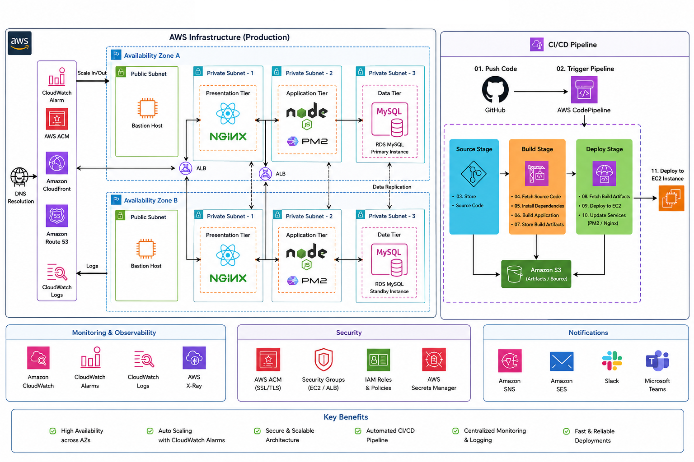

# ☁️ CloudFortress -- Highly Available AWS Three-Tier Architecture with Automated CI/CD

**Building a Secure, Scalable, and Production-Grade AWS Infrastructure**



## 📌 Project Overview

**CloudFortress** is an enterprise-style AWS cloud infrastructure
project designed to deploy a highly available, secure, and scalable
three-tier web application.

The architecture follows a Multi-AZ deployment strategy to improve
application availability and resilience. It separates the Presentation,
Application, and Database tiers into dedicated private subnets across
two Availability Zones.

The project also implements an automated CI/CD pipeline using GitHub and
AWS CodePipeline to automate source integration, application builds,
artifact storage, and deployment to EC2 instances.

It incorporates centralized monitoring, logging, security controls, and
notification integrations to support reliable application operations.

## 🏗️ Architecture Components

### 1. Network & Infrastructure

-   **Amazon VPC:** Isolated networking environment for AWS resources.
-   **Public Subnets:** Host Bastion Hosts and internet-facing
    infrastructure.
-   **Private Subnets:** Host Presentation, Application, and Database
    tiers.
-   **Multi-AZ Deployment:** Infrastructure distributed across
    Availability Zone A and B.
-   **Application Load Balancer (ALB):** Distributes incoming
    application traffic.
-   **Bastion Host:** Provides controlled SSH access to private
    instances.
-   **Auto Scaling:** Supports automatic scaling based on CloudWatch
    alarms.

### 2. Presentation Tier

-   **React.js:** Frontend application.
-   **Nginx:** Web server and reverse proxy.
-   Deployed on EC2 instances in private subnets.
-   Load balancing across Availability Zones.

### 3. Application Tier

-   **Node.js:** Backend application.
-   **PM2:** Process manager for Node.js applications.
-   Deployed on EC2 instances in private subnets.
-   Internal load balancing for application traffic.

### 4. Database Tier

-   **Amazon RDS MySQL:** Managed relational database service.
-   Primary database instance in Availability Zone A.
-   Standby database instance in Availability Zone B.
-   Database replication and Multi-AZ availability.

### 5. Content Delivery & DNS

-   **Amazon CloudFront:** Content delivery and caching.
-   **Amazon Route 53:** DNS management and domain resolution.
-   **AWS Certificate Manager (ACM):** SSL/TLS certificate management.

## ⚙️ CI/CD Pipeline

The project implements an automated CI/CD workflow using GitHub and AWS
CodePipeline.

### Pipeline Workflow

  -----------------------------------------------------------------------
  Stage                               Description
  ----------------------------------- -----------------------------------
  Source Stage                        Fetch application source code from
                                      GitHub

  Build Stage                         Install dependencies and build the
                                      application

  Artifact Storage                    Store source and build artifacts in
                                      Amazon S3

  Deploy Stage                        Fetch build artifacts and deploy to
                                      EC2 instances

  Service Update                      Update and restart application
                                      services using PM2 and Nginx
  -----------------------------------------------------------------------

### CI/CD Pipeline Flow

``` text
Developer Pushes Code
        |
        v
      GitHub
        |
        v
  AWS CodePipeline
        |
        v
    Source Stage
        |
        v
     Build Stage
        |
        v
   Amazon S3
 (Build Artifacts)
        |
        v
    Deploy Stage
        |
        v
   EC2 Instances
        |
        v
 Update PM2 / Nginx
        |
        v
 Application Running
```

The pipeline automates application delivery and reduces manual
deployment effort.

## 📊 Monitoring & Observability

-   **Amazon CloudWatch:** Infrastructure and application monitoring.
-   **CloudWatch Alarms:** Monitor metrics and trigger scaling actions.
-   **CloudWatch Logs:** Centralized log collection and analysis.
-   **AWS X-Ray:** Application tracing and performance analysis.

## 🔐 Security Implementation

-   **AWS Security Groups:** Control inbound and outbound traffic.
-   **IAM Roles & Policies:** Provide controlled AWS service
    permissions.
-   **AWS ACM:** Manage SSL/TLS certificates.
-   **AWS Secrets Manager:** Secure storage of application secrets.
-   **Private Subnets:** Keep application and database resources
    isolated from direct public access.
-   **Bastion Host:** Controlled administrative access to private
    infrastructure.

## 🔔 Notification Integrations

-   Amazon SNS
-   Amazon SES
-   Slack
-   Microsoft Teams

## 🛠️ Technologies & AWS Services

  Category             Technologies
  -------------------- -------------------------------------------
  Cloud Platform       Amazon Web Services (AWS)
  Compute              Amazon EC2
  Networking           VPC, Public Subnets, Private Subnets
  Load Balancing       Application Load Balancer
  Scalability          EC2 Auto Scaling, CloudWatch Alarms
  Database             Amazon RDS MySQL
  Frontend             React.js
  Backend              Node.js
  Process Management   PM2
  Web Server           Nginx
  CI/CD                GitHub, AWS CodePipeline
  Artifact Storage     Amazon S3
  DNS                  Amazon Route 53
  CDN                  Amazon CloudFront
  SSL/TLS              AWS Certificate Manager
  Monitoring           Amazon CloudWatch, AWS X-Ray
  Security             IAM, Security Groups, AWS Secrets Manager
  Notifications        SNS, SES, Slack, Microsoft Teams

## 📁 Repository Structure

``` text
cloudfortress-aws-high-availability-cicd/
│
├── architucture/
│   └── Architecture.png
│
├── backend/
│
├── frontend/
│
├── AWS CICD Pipeline - AWS.txt
│
├── app-tier-user-data.txt
│
├── web-tier-user-data.txt
│
└── README.md
```

## 🚀 Key Project Highlights

-   Highly available Multi-AZ AWS architecture.
-   Three-tier application deployment.
-   Separation of frontend, backend, and database layers.
-   Load balancing across infrastructure tiers.
-   Automated application deployment using AWS CI/CD services.
-   CloudWatch-based monitoring and scaling.
-   Secure access management using IAM and Security Groups.
-   Managed MySQL database with Multi-AZ standby.
-   Centralized logging and application tracing.

## 🎯 Learning Outcomes

Through this project, I gained practical experience in:

-   Designing production-style AWS cloud architecture.
-   Implementing highly available Multi-AZ infrastructure.
-   Deploying full-stack applications on EC2.
-   Configuring Application Load Balancers and Auto Scaling.
-   Implementing automated CI/CD pipelines.
-   Managing AWS networking and security.
-   Monitoring infrastructure using CloudWatch.
-   Understanding database high availability using Amazon RDS.

## ⚠️ Important Note

This project is intended for educational and hands-on DevOps learning
purposes.

-   AWS resources may incur charges depending on usage.
-   Review AWS pricing before deploying resources.
-   Never commit AWS access keys, passwords, database credentials, or
    other secrets to GitHub.
-   Configure appropriate IAM permissions and security rules before
    deployment.
-   Verify actual service configuration and health before using the
    architecture in production.

## 👨‍💻 Author

**Abhishek Saste**

GitHub:
[@abhisheksaste31-source](https://github.com/abhisheksaste31-source)

## ⭐ Support

If you find this project useful, consider giving this repository a ⭐ on
GitHub.

Your support and feedback are appreciated!

------------------------------------------------------------------------

**CloudFortress -- Building Resilient Infrastructure. Automating Cloud
Deployments. 🚀**
